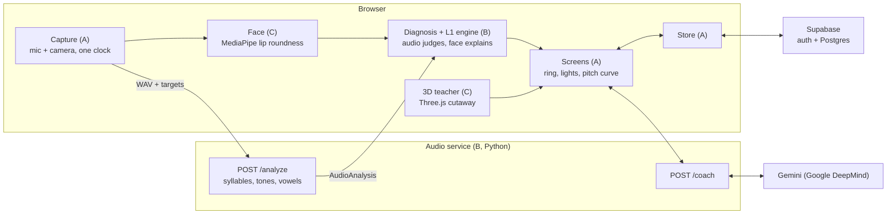

# Orbi: Mandarin tone & mouth-shape coach — 3-hour build spec

Version 2 · 2026-10-10. Version 1 was a 24-hour, 4-agent plan (working name ToneMirror). This version cuts it to **3 hours and 3 people (2 at the start)**, adds **Google DeepMind's Gemini** and **Supabase**, and folds in the parts of the "3D teacher / onboarding" plan that make the app friendlier without duplicating what we already had. What was taken from that plan, and what was left out and why, is in [Changes from the 3D-teacher plan](#changes-from-the-3d-teacher-plan).

How the three of us split the work: [docs/WORKFLOW.md](docs/WORKFLOW.md).

## Overview

Orbi is a browser app that listens to a learner say a Mandarin word, watches their lips, and tells them which tone or mouth shape went wrong and how to fix it. A 3D teacher head shows what the mouth and tongue should do. The demo proves one claim: combining audio with face tracking turns "you got it wrong" into "here is what your mouth did, and here is what to do instead."

The product goal for this build is a **clear, friendly experience**: one obvious action per screen, no jargon, every result explained in plain words.

**In scope**

- Onboarding: pick your native language, a 10-second voice and face calibration, and a short "what speakers of your language usually find hard" card.
- Tones on 1–3 syllable words, including tone sandhi (3+3, 不, 一) and the half third tone.
- One vowel family done properly: i / ü / u, diagnosed with formants plus lip rounding.
- Results as a **match ring** plus three **guidance lights** (Pitch, Lips, Tongue), the pitch curve against the target, and at most two fixes in plain words.
- A **3D teacher head** with a see-through cutaway that shows lips and tongue for the target sound, and highlights what to fix.
- **Gemini** (Google DeepMind) rewrites each fix as a friendly tip that mentions the learner's native language when it's relevant, and generates the native reference audio.
- **Supabase** keeps each learner's profile and progress (anonymous sign-in, no account needed). A 3-in-a-row streak marks a word as mastered.

**Out of scope (say "next" if judges ask)**

- Free conversation and full-sentence scoring.
- Tongue-only contrasts: zh/z, -n/-ng. The camera can't see the tongue.
- Live feedback while speaking (a ring that moves as you talk), extra drill modes, other target languages, mobile app, training any ML model.

**Assumptions**: a 3-hour build; 2 people from the start and a third joining later, each with a coding agent; laptops with webcams; a Gemini API key and a Supabase project created in the first 15 minutes.

**Demo success criteria**

- Results appear under 3 seconds after the learner stops speaking. Gemini's tip may arrive later and never blocks the screen.
- The four rehearsed demo attempts give the intended result at least 9 of 10 tries.
- Everything still works with Wi-Fi off, except Gemini tips (template text shows instead) and cloud sync (progress stays in the browser).

## Demo script

Three minutes, building to one moment: the same wrong word gets two different fixes, depending on what the learner's mouth did.

| Time | Presenter does | Screen shows | What it proves |
|---|---|---|---|
| 0:00–0:15 | Hook: "Apps give you a score. A teacher tells you what your mouth is doing. We built the teacher." | Welcome screen | The problem |
| 0:15–0:45 | Onboarding: picks English, does the 10-second calibration | Calibration dots and live lip overlay, then "English speakers often find tones and ü hard" | It adapts to each voice, face and native language |
| 0:45–1:10 | Says 妈 麻 马 骂 with a tone 2 that dips before rising | Ring amber; Pitch light: "You dipped before rising, which sounds like tone 3". Retry: ring green, streak 1 of 3 | Tone feedback anyone can read |
| 1:10–1:30 | Says 你好 with two full tone-3 dips | Pitch light on 你: "Before another tone 3, 你 becomes ní"; target vs. your curve | It knows sandhi rules, not a lookup |
| 1:30–1:55 | Says 女 nǚ as "nee" (lips spread) | Lips light red; the teacher's lips glow and round. Fix: "Keep your tongue as for 'ee', round your lips" | The face explains the error |
| 1:55–2:15 | Says 女 as "noo" (lips rounded, tongue back) | Lips green, Tongue light red; the cutaway shows the tongue moving forward. Gemini tip mentions English has no ü | Same wrong word, different fix |
| 2:15–2:35 | Says 女 correctly; reloads the page | Ring green; progress and profile come back from Supabase | It recognizes success and remembers you |
| 2:35–3:00 | Close on the architecture | Gemini + Supabase + MediaPipe; next: live feedback, more sounds, mobile | Credible roadmap |

**Rehearsal notes**

- Practice the deliberate wrong versions until they're reliable. The app is honest; a sloppy "wrong" take may come out right.
- Use a headset or lapel mic, and put a light in front of the presenter's face, never behind.
- Keep demo mode (replays recorded attempts through the real UI) and a backup screen recording ready.

## Architecture and tech stack

The browser handles capture, face tracking, the 3D teacher, diagnosis and UI; a small Python service handles pitch and formant analysis and talks to Gemini; Supabase stores profiles and progress.



Video never leaves the laptop: only lip numbers are kept. Audio goes to the local service.

| Layer | Choice | Why | Lane |
|---|---|---|---|
| Frontend | Vite + React + TypeScript | Fast to scaffold; agents know it well | A |
| Audio capture | `getUserMedia`, AudioWorklet, 16 kHz mono WAV encoded in the browser | No ffmpeg on the server | A |
| Face tracking | `@mediapipe/tasks-vision` FaceLandmarker, VIDEO mode, GPU delegate | 478 landmarks + 52 blendshapes in real time, on device | C |
| 3D teacher | `three` + `@react-three/fiber` + `@react-three/drei`, procedural geometry | No model files to download or fail; orbit controls for free | C |
| Audio analysis | Python 3.11, FastAPI, `praat-parselmouth`, numpy, scipy | Praat-grade pitch and formants | B |
| Diagnosis | Pure TypeScript, rules stored as data | Unit-testable, no network | B |
| Coaching text | **Gemini** `gemini-3.5-flash-lite` via `POST /coach` (google-genai SDK) | Fastest Gemini text model; phrasing only, never diagnosis | B |
| Reference audio | **Gemini TTS** `gemini-3.8-flash-tts`, generated once by a script | Native-sounding Mandarin without a recording session | B |
| Profiles and progress | **Supabase**: anonymous auth + Postgres with row-level security, `@supabase/supabase-js` | No sign-up friction; progress survives reloads and devices | A |

**Repo layout**

```
orbi/
  SPEC.md  AGENTS.md  NOTES.md  docs/
  shared/contracts/types.ts     # source of truth for data shapes
  shared/fixtures/              # generated results for every prompt (+ golden WAVs later)
  supabase/migrations/          # tables and row-level security
  apps/web/
    public/models/              # face_landmarker.task + WASM (C)
    public/ref/                 # Gemini TTS reference audio (B)
    src/ui/ src/capture/ src/api/ src/data/ src/fixtures.ts   # A
    src/face/ src/teacher/                                     # C
    src/diagnosis/ src/content/                                # B
  services/audio/               # FastAPI service, Gemini coaching, TTS script (B)
```

**Request flow for one attempt**

1. The learner presses record (or the space bar). The face loop logs lip features about 30 times a second; the mic records audio. Both use the same clock.
2. Recording stops after 600 ms of silence, or at 3 seconds.
3. The browser posts the WAV, the syllable targets from `targetsFor()` and the calibration to `POST /analyze`.
4. The service returns syllable timings, tone results and vowel formants.
5. The face module summarizes lip features inside each vowel's time window.
6. `diagnose()` merges audio and face evidence into at most two fixes, each with an L1 note when one applies.
7. The UI renders the ring, lights, pitch curve and fixes at once, saves the attempt, then swaps in Gemini's tips from `POST /coach` if they arrive within 2.5 seconds.

## Shared data contracts

[`shared/contracts/types.ts`](shared/contracts/types.ts) is the only coupling between lanes; read it rather than a copy. It is mirrored as pydantic models in `services/audio/app/models.py` and as tables in `supabase/migrations/`. Times are seconds from recording start; pitch levels use the Chao 1–5 tone scale. Change it only through the contract process in docs/WORKFLOW.md §3.

The main shapes: `PromptItem` (a practice word), `SyllableTarget` (surface tone after sandhi), `Calibration`, `AudioAnalysis` (per-syllable `ToneResult` and `VowelResult`), `FaceSummary` (per-syllable `roundness`), `FeedbackItem` (a fix: diagnosis, title, instruction, optional Gemini `coaching` and `l1Note`), `Profile` (`l1` + calibration) and `AttemptRecord` (one attempt's pass, score and issues).

**Endpoints (audio service)**

| Method and path | Request | Response |
|---|---|---|
| `POST /analyze` | multipart: `audio` (WAV), `meta` (JSON `AnalyzeMeta`: `promptId`, `targets`, `calibration`) | `AudioAnalysis` |
| `POST /calibrate/audio` | multipart: `glide`, `ee`, `oo`, `ah` WAVs | `AudioCalibration` |
| `POST /coach` | `CoachRequest`: `{ prompt, items: FeedbackItem[], l1 }` | `{ tips: { issueId, text }[] }` |
| `GET /health` | none | `{ ok: true }` |

**In-browser seams**: `targetsFor(prompt)` and `diagnose(prompt, audio, face, l1)` in `src/diagnosis/index.ts` (B), `<TeacherHead pose highlight />` in `src/teacher/index.tsx` (C), and `loadProfile / saveProfile / saveAttempt / loadAttempts` in `src/data/store.ts` (A).

**Fixtures**: `shared/fixtures/` holds an `AudioAnalysis` and a `FaceSummary[]` for every prompt, plus the deliberate mistakes from the demo, with the fixes `diagnose()` should return. With `VITE_AUDIO_MODE=fixture` the web app runs without the service; with `VITE_FACE_MODE=fixture` it runs without a camera. Every lane ships a mock behind its seam first, so nobody waits.

## Module A: recording and alignment

Record a 16 kHz mono WAV per attempt (lane A) and split it into syllables using voicing and loudness (lane B). No forced aligner is needed, because every prompt is 1–4 known syllables.

**Capture (browser, lane A)**

- `getUserMedia({ audio: { echoCancellation: false, autoGainControl: false }, video: { width: 640, height: 480, facingMode: "user" } })`. Try `noiseSuppression` on and off in the room and keep whichever gives cleaner pitch.
- One clock: `t0 = performance.now()` when audio capture starts. The face loop stamps frames as `(performance.now() - t0) / 1000`.
- Capture raw PCM with an AudioWorklet, downsample to 16 kHz, encode 16-bit WAV in the browser.
- Visual 3-2-1 countdown, then record. Auto-stop after 600 ms below the speech threshold once speech has started, or at 3.0 s (4.0 s for list prompts).
- Live level meter. Before sending, reject a peak under −30 dBFS ("I couldn't hear you, try a bit louder") or more than 1% clipped samples ("Move back from the mic a little").

**Segmentation (service, lane B), in `segment.py`**

1. Pitch: `snd.to_pitch_ac(time_step=0.01, pitch_floor=0.7*lowHz, pitch_ceiling=1.5*highHz)`. Before calibration, use 75 and 500 Hz.
2. Loudness: `snd.to_intensity(time_step=0.01)`. Speech frames are those within 25 dB of the loudest frame.
3. Voiced runs: frames that are both voiced and speech. Merge runs separated by under 60 ms; drop runs shorter than 60 ms.
4. Match the expected syllable count N:
   1. Exactly N runs: done.
   2. Fewer: split the longest run at its deepest loudness dip (at least 3 dB below both neighbors). Repeat until N.
   3. More: merge the pair with the shortest gap. Repeat until N.
   4. Still impossible: add warning `syllable_count_mismatch` and return the best effort.
5. Vowel window per syllable: drop the first 30% (onset consonant, voiced initials like n and m) and the last 15%. For vowel-focus syllables, use the central 40%.

**Done when**: 9 of 10 teammate recordings of the demo words segment correctly, checked by eye.

## Module B: tone analysis

Each syllable's pitch is scaled to the learner's own voice range, mapped to the 1–5 tone scale, and compared with a target template that already accounts for tone sandhi. Comparing contour shapes inside the learner's range, not raw hertz, is what makes it fair for deep and high voices alike.

### B1. Targets from pinyin (TypeScript, lane B: `src/diagnosis/sandhi.ts`)

Apply in this order to the written tones:

1. 不 `bu4` becomes `bu2` before a tone 4.
2. 一 `yi1` becomes `yi2` before a tone 4, and `yi4` before tones 1, 2 and 3. It stays `yi1` when final.
3. In a run of third tones, all but the last become tone 2.
4. A remaining tone 3 that is not final becomes `T3_half`; a final or isolated one is `T3_full`. In `reading: "list"` prompts, every syllable counts as isolated.
5. Neutral tone (5) sits at a height set by the previous tone: after tone 1 at level 2, after 2 at 3, after 3 at 4, after 4 at 1. It is short and flat.

Each changed syllable gets a `sandhiNote` the UI can show, for example "3+3 → 2+3".

### B2. Contour extraction (Python, lane B: `tone.py`)

1. Take voiced pitch frames inside the syllable; trim 10% from each end.
2. Fill gaps of 80 ms or less by linear interpolation; apply a 5-frame median filter.
3. Convert to semitones: `st = 12 * log2(f0 / medianHz)`.
4. Scale to the tone scale: `level = 1 + 4 * (st - lowSt) / (highSt - lowSt)`, clamped to 0.5–5.5. `lowSt` and `highSt` come from the 5th and 95th percentile of the calibration siren glide.
5. Resample to 10 evenly spaced points.

**Creaky voice**: tone 3 often turns creaky at the bottom, and pitch trackers drop out there. If a tone-3 target has a gap in its middle 60% but voiced edges, fill the gap with level 1 instead of flagging `no_pitch`.

### B3. Templates

Build each 10-point template by linear interpolation between anchor points (position 0–1, level 1–5).

| Variant | Anchors | Shape |
|---|---|---|
| `T1` | (0, 5) → (1, 5) | High, level |
| `T2` | (0, 3) → (0.2, 2.7) → (1, 5) | Mid, slight dip, rise |
| `T3_full` | (0, 2) → (0.6, 1) → (1, 4) | Low dip, then rise |
| `T3_half` | (0, 2) → (1, 1) | Low, falling, no rise |
| `T4` | (0, 5) → (1, 1) | High to low |
| `T5` | flat at the B1 rule height | Short, light |

### B4. Scoring

- `rmse` = root-mean-square distance between produced and target points, in tone-scale levels.
- Status: 0.6 or less is green, up to 1.1 is amber, above 1.1 is red.
- `score = round(100 * clamp(1 - rmse / 2, 0, 1))`.
- `nearest` = the template with the smallest rmse. If it differs from the target and beats it by more than 0.3, add `wrong_tone` ("sounded like tone 3").

### B5. Issue detectors

Start, end, min and max refer to the 10-point produced contour.

| Issue | Rule | Message template |
|---|---|---|
| `t1_drift` | abs(end − start) > 1.0 | Keep it flat; your tone 1 slid {up/down}. |
| `t1_low` | mean < 3.8 | Tone 1 sits at the top of your voice. Start higher. |
| `t2_shallow` | max − min < 1.5 | Rise more: from the middle of your voice to the top. |
| `t2_late` | min falls after point 4 and dips ≥ 0.7 below start | You dipped before rising, which sounds like tone 3. Start rising right away. |
| `t3_not_low` | min > 2.0 | Go lower. Tone 3 lives at the bottom of your voice. |
| `t3_full_in_context` | target `T3_half` and end − min > 1.5 | Info only: mid-phrase, tone 3 just stays low. |
| `t4_shallow` | start − end < 2.0 | Fall further, from top to bottom, like a firm "No!" |
| `t4_low_start` | start < 4.0 | Start tone 4 higher. |
| `no_pitch` | voicedRatio < 0.3 | I couldn't hear a clear pitch. Try again a bit louder. |

`shared/fixtures/make_fixtures.py` implements B3–B5; its fixtures are the oracle for `tone.py`.

**Done when**: unit tests on synthetic contours pass for every template and issue; native reference audio scores green on at least 90% of syllables; every deliberate demo mistake gets flagged.

## Module C: segment check (vowels)

The demo checks one vowel family, i / ü / u, using formants measured against the learner's own "ee" and "oo" from calibration. Rounding the lips lowers F2 and especially F3; pulling the tongue back lowers F2 a lot. That splits the two classic learner errors cleanly.

**Procedure (Python, lane B: `vowel.py`)**

1. Formant ceiling: 5500 Hz if the calibration median F0 is above 165 Hz, else 5000 Hz. Call `snd.to_formant_burg(time_step=0.01, max_number_of_formants=5, maximum_formant=ceiling, window_length=0.025)`.
2. In the vowel window, take the median F1, F2, F3. Also take median F2 in the first and last thirds, for glide detection.
3. Normalize against calibration: `f2n = (F2 - F2_u) / (F2_i - F2_u)` and `f3ratio = F3 / F3_i`.
4. Classify (starting thresholds; tune on teammates' recordings):
   - `f2n < 0.45` → heard as **u** (tongue back)
   - else `f3ratio < 0.90` → heard as **ü** (front and rounded)
   - else → heard as **i** (front, unrounded)
   - `abs(F2_last - F2_first) / F2_mid > 0.25` → `glide: true` (a slide like English "you")
5. Confidence: distance from the nearest threshold, scaled to 0–1. Below 0.3, the diagnosis engine still lets the audio decide but words the fix more cautiously.

**Pinyin trap**: ü is written as plain u after j, q, x and y (qù, xué, yú). Content marks these syllables as vowel `y`, and the UI notes "this u is really ü".

**Done when**: across 10 recordings each of a teammate saying nǚ, "nee" and "noo", `heardAs` is right at least 9 of 10 times per category.

## Module D: face tracking and lip checks

MediaPipe FaceLandmarker runs in the browser at camera rate and logs a few lip measurements per frame (lane C). No video leaves the laptop; only numbers and one mouth snapshot are kept, locally.

**Setup (lane C: `src/face/`)**

- `FaceLandmarker.createFromOptions` with `runningMode: "VIDEO"`, `numFaces: 1`, `outputFaceBlendshapes: true`, `delegate: "GPU"` (fall back to CPU on error).
- Serve `face_landmarker.task` and the WASM files from `public/models/`. Don't depend on a CDN at the venue.
- Loop on `requestAnimationFrame`: `detectForVideo(video, performance.now())`. While recording, push a `FaceFeatures` row every frame and an `ImageBitmap` about 10 times a second (for snapshots). Otherwise keep a 3-second ring buffer.

**Features per frame.** Verify these landmark indices first by drawing them on the preview.

| Feature | Source | Notes |
|---|---|---|
| Scale unit | Distance between outer eye corners, landmarks 33 and 263 | Makes features independent of distance to camera |
| `lipWidth` | Inner mouth corners, landmarks 78 and 308 | Divided by scale unit |
| `lipHeight` | Inner lip midpoints, landmarks 13 and 14 | Divided by scale unit |
| `pucker`, `funnel`, `jawOpen` | Blendshapes `mouthPucker`, `mouthFunnel`, `jawOpen` | Already 0–1 |
| `smile` | Mean of `mouthSmileLeft` and `mouthSmileRight` | Helps detect spread lips |

**Roundness score**

```
widthTerm  = (W_ee - W) / (W_ee - W_oo)          // from face calibration
puckerTerm = (P - P_ee) / (P_oo - P_ee)
roundness  = clamp(0.6 * widthTerm + 0.4 * puckerTerm, 0, 1)
```

Roundness of 0.6 or more counts as rounded, 0.3 or less as spread, anything between as partly rounded.

**Summary per syllable**: medians of `roundness` and `jawOpen` over the syllable's vowel window (widened by 40 ms each side to absorb sync error); `coverage` = share of frames with a face; `snapshot` = mouth crop nearest the vowel midpoint, as a data URL.

**Live quality checks**, as a friendly banner on the preview: face found in under 80% of frames → "Keep your face in view"; eye-corner distance under 60 px → "Move a little closer"; nose off-center by more than 0.15 of the eye distance → "Face the camera".

**Live overlay**: lip contour and a small roundness bar on the preview, so people see tracking work in real time.

**Done when**: on calibration poses, roundness separates "ee" from "oo" by at least 0.5 for each teammate, and a 1-second vowel summary computes in under 20 ms.

## Module E: diagnosis rules engine

Audio decides whether a sound is wrong; the face only explains why. This keeps face-tracking noise from ever failing a correct pronunciation, and it's the core design idea worth telling judges.

**Engine (lane B: `src/diagnosis/`)**

- Pure function: `diagnose(prompt, audio, face, l1): FeedbackItem[]`.
- Rules live in `rules.ts` as data: `{ id, appliesTo, when: (ctx) => boolean, articulator, severity, messageKey, targetVisual }`.
- For each syllable, evaluate rules in order; the first match per articulator wins.
- Message templates live in `messages.ts`, keyed by `messageKey`, with `{placeholders}`.
- Each card gets `l1Note` from the L1 engine (Module H) when its issue is a known tendency for the learner's language.

**Vowel rules, target ü**

| Heard as | Lips | Issue | Fix shown | Severity |
|---|---|---|---|---|
| any | any, with `glide: true` | `y_glide` | Don't slide like English "you". Hold one mouth shape from start to end. | 3 |
| i | spread or partly | `y_lips_not_rounded` | Keep your tongue exactly as for "ee". Now push your lips into a small, tight circle. | 3 |
| u | rounded | `y_tongue_back` | Your lips are right. Your tongue slid back to "oo": keep the tip touching your lower front teeth. | 3 |
| u | spread or partly | `y_both` | Start from "ee", hold your tongue still, then round your lips. | 3 |
| ü | spread | `y_ok_lips_hint` | Sounds right. Rounding your lips more will make it steadier. | 1 |
| ü | rounded or partly | pass | none | none |

**Other vowel targets**

| Target | Heard as | Lips | Issue | Fix shown |
|---|---|---|---|---|
| u | i or ü | partly or spread | `u_fronted` | Round tighter and pull your tongue back, deeper than English "oo". |
| i | ü | rounded | `i_rounded` | Spread your lips, like a slight smile. |

**When the face is missing** (coverage under 0.5): use audio-only messages that name both possible causes, for example "Sounded like 'ee': round your lips, keep your tongue forward."

**Tone rules**: each `ToneIssueId` maps to a diagnosis with `articulator: "pitch"`. `wrong_tone` and `no_pitch` are severity 3; `t3_full_in_context` is severity 1 (info); the rest are 2. Rule order is in NOTES.md (sandhi syllables show `wrong_tone` with the sandhi explanation; otherwise the specific detector wins).

**Prioritization**: at most two fix cards per attempt; highest severity first, ties to the earlier syllable; one card per syllable unless its tone and vowel issues are both severity 3; correct syllables get no card.

**Done when**: table-driven tests cover every row, and `src/diagnosis/diagnosis.test.ts` (skipped until then) passes on all fixtures.

## Module F: screens, results and coaching

Lane A. The goal of this module is that a first-time learner never wonders what to do next or what a result means.

**UI principles**

- One primary action per screen, in a large button; the space bar also records.
- Plain words only. No Hz, rmse or formants outside the Details toggle.
- Every status uses color + icon + word (works for color-blind people).
- Nothing waits on the network: results render at once, Gemini tips swap in, saving happens in the background.
- Friendly errors that say what to do ("I couldn't hear you, try a bit louder").
- Calm motion, and none when `prefers-reduced-motion` is set. Works at laptop and tablet width.

**Screens**

1. **Welcome / onboarding** (first visit; skipped when a profile exists):
   1. Welcome: one sentence on what Orbi does, "Get started".
   2. Native language: big tiles from `L1S` in `src/content/l1.ts`.
   3. Calibration, about 10 seconds: the neutral face is captured while the learner reads the instructions; then a siren glide from high to low (3 s), "ee" held (2 s), "oo" held (2 s), "ah" held (2 s). Progress dots, live waveform, live lip overlay. Sent to `/calibrate/audio`; face poses kept from the same takes.
   4. "Speakers of {language} often find…": the 1–2 notes for their L1, then "Start practicing". Profile saved via `saveProfile`.
2. **Home**: practice sets (Tones, Sandhi, The ü sound) as cards, each word showing a check when mastered (3 green attempts in a row); Demo mode; "Redo calibration" in a corner.
3. **Practice**: large hanzi, pinyin with tone marks, English gloss; "Hear it" plays `/ref/<id>.wav` (Gemini TTS); the 3D teacher in the target pose for vowel words; camera preview with lip overlay and roundness bar; the big record button with a 3-2-1 countdown and auto-stop.
4. **Results**:
   - **Match ring**: one number 0–100 and a word. Match = mean of the syllables' tone scores, with any syllable that has a severity-3 card capped at 40. Green "Nailed it" when there's no card of severity 2 or 3 and match ≥ 80; red "Try again" when any card is severity 3; amber "Almost" otherwise.
   - **Guidance lights**: Pitch, Lips, Tongue. Green check, or the matching fix card's title. Grey "not part of this word" for lights the prompt doesn't check (Lips and Tongue on tone-only words).
   - **Pitch panel**: SVG with gridlines at levels 1–5; per syllable, a dashed target curve and a solid learner curve, with the sandhi note when one applied ("你 becomes ní before another tone 3").
   - **Teacher**: target pose, with the faulty articulator highlighted (vowel words).
   - **Fix cards** (at most two): title, instruction, the L1 note in a soft callout; the instruction is replaced by Gemini's tip when it arrives.
   - **Streak**: "2 of 3 in a row"; the third green shows "Mastered!" and marks the word on Home.
   - **Details** toggle: per-syllable score, rmse, formants and the lip snapshot, for the curious.
   - Buttons: Try again (keeps the last attempt drawn faintly), Hear yourself, Hear it, Next word.
5. **Demo mode**: replays the fixture attempts that have a `beat`, in order, through these same screens.

**Coaching endpoint (lane B: `services/audio/app/coach.py`, done)**

- `POST /coach` receives the prompt, the fix cards and the learner's L1; returns one rewritten tip per card.
- Gemini `gemini-3.5-flash-lite` through the google-genai SDK's Interactions API, `thinking_level: "minimal"`, at most 120 output tokens, one request per card in parallel, 2.5 s timeout. Any failure returns the template text. Key in `services/audio/.env` as `GEMINI_API_KEY`, never in the browser.
- System prompt: rephrase only, never change the diagnosis; physical actions, not phonetic terms; compare sounds to common English words; weave in the L1 note briefly; no praise filler.

## Module G: 3D teacher head (lane C)

A stylized head with a see-through skin and a sagittal cutaway, so the learner sees what the lips **and the tongue** should do. This is what makes the "same word, different fix" moment land: for ü the teacher shows the tongue forward like "ee" with the lips rounded like "oo".

- **Interface** (stable, already used by the UI): `<TeacherHead pose={"i" | "y" | "u" | "a" | "rest"} highlight={"lips" | "tongue" | null} />` from `src/teacher/index.tsx`. Today it's a flat SVG placeholder; replace its body.
- **Stack**: `three`, `@react-three/fiber`, `@react-three/drei` (`OrbitControls`). Procedural geometry only, no model files: head shell (scaled sphere, `MeshPhysicalMaterial`, low opacity, double-sided), a clipping plane on the mid-sagittal line to cut the head open, palate, upper and lower teeth arcs, tongue (ellipsoid you move and tilt), lips (two flattened tori you scale for spread vs. round and push forward), lower jaw that rotates open.
- **Poses** (parameters 0–1; exaggerate the target shape about 20%, which research found helps learners):

| Pose | Lip width | Rounding / protrusion | Jaw open | Tongue front→back | Tongue height |
|---|---|---|---|---|---|
| rest | 0.5 | 0 | 0.1 | 0.5 | 0.4 |
| i | 0.9 (spread) | 0 | 0.15 | 0.2 | 0.9 |
| y (ü) | 0.2 | 1 | 0.15 | 0.2 | 0.9 |
| u | 0.2 | 1 | 0.2 | 0.85 | 0.8 |
| a | 0.5 | 0.1 | 0.8 | 0.5 | 0.1 |

- **Motion**: ease between poses in about 250 ms; subtle idle breathing; a pulsing glow on the highlighted part. No motion beyond the pose change when `prefers-reduced-motion` is set.
- **Camera**: a three-quarter view that shows both the lips and the cutaway; orbit limited so the head can't be lost.
- **Performance**: lazy-load the 3D code (`React.lazy`) so the first screen stays fast; fall back to the SVG placeholder if WebGL isn't available; must run smoothly next to MediaPipe on the demo laptop.
- **Done when**: i, ü and u are clearly different at a glance, the ü pose shows "tongue like i, lips like u", highlights work, and it holds 60 fps with the camera running.

## Module H: native-language (L1) engine (lane B, onboarding UI by lane A)

Learners make predictable mistakes based on their native language. Orbi uses that to explain, never to judge: the audio still decides what's wrong.

- Data: `src/content/l1.ts` lists the supported languages (English, Spanish, French, Japanese, Korean, Vietnamese, other) and, for each, tendencies as `{ issueIds, note }`. Seeded with conservative patterns (English and Spanish have no ü; non-tonal languages flatten tones; Japanese pitch accent makes tones 2 and 3 the tricky ones; Vietnamese maps tones onto its own). Review the wording with whoever speaks Mandarin best.
- Onboarding shows the learner's notes; `diagnose()` attaches `l1Note` to matching cards via `l1NoteFor(l1, issueId)`; `/coach` passes the L1 and note to Gemini so the tip can mention it naturally.

## Module I: profiles and progress (Supabase, lane A)

- **Auth**: Supabase anonymous sign-in on first visit, so there's no account to create. (Turn on "Allow anonymous sign-ins" in the Supabase dashboard.)
- **Tables** (`supabase/migrations/0001_init.sql`): `profiles` (one row per learner: `l1`, `calibration`) and `attempts` (one row per attempt: `prompt_id`, `passed`, `score`, `issue_ids`). Row-level security: each learner reads and writes only their own rows.
- **Client**: `src/data/store.ts` (done) exposes `loadProfile`, `saveProfile`, `saveAttempt`, `loadAttempts`. Without Supabase settings, or when the network fails, it uses localStorage, so the demo works offline.
- Home derives "mastered" from attempts: three passes in a row on a word.

## Content: prompts, reference audio and recordings

Eleven prompts cover every demo beat; four are rehearsed. They live in `src/content/prompts.ts` (done).

| ID | Hanzi | Written pinyin | Surface target | Focus | Demo beat |
|---|---|---|---|---|---|
| `ma4` | 妈 麻 马 骂 | ma1 ma2 ma3 ma4 (list) | unchanged, 马 full tone 3 | Tone | Tones |
| `nihao` | 你好 | ni3 hao3 | ni2 hao3 | Sandhi 3+3 | Sandhi |
| `nv` | 女 | nv3 | nv3, vowel ü | ü + tone | Money shot |
| `ni` | 你 | ni3 | vowel i | Contrast for ü | Practice |
| `nu` | 努 | nu3 | vowel u | Contrast for ü | Practice |
| `qu` | 去 | qu4 | vowel ü, written u | Pinyin trap | Practice |
| `yu` | 鱼 | yu2 | vowel ü, written u | ü + tone 2 | Practice |
| `bushi` | 不是 | bu4 shi4 | bu2 shi4 | Sandhi 不 | Practice |
| `yige` | 一个 | yi1 ge4 | yi2 ge4 | Sandhi 一 | Practice |
| `laoshi` | 老师 | lao3 shi1 | half tone 3 + tone 1 | Half third tone | Practice |
| `zhongguo` | 中国 | zhong1 guo2 | unchanged | Tones 1 + 2 | Practice |

**Reference audio**: `services/audio/scripts/make_reference_audio.py` asks Gemini TTS (`gemini-3.8-flash-tts`) for each prompt and writes `apps/web/public/ref/<id>.wav`. Listen to every file; if a tone sounds off, regenerate it or record a fluent speaker instead.

**Recordings for tuning** (whoever speaks Mandarin best, in the first hour): two takes each of the four demo attempts done right, 女 as "nee", "noo" and "yoo", 麻 dipping before the rise, 你好 with two full dips. Save as `shared/fixtures/audio/<promptId>.<variant>.<take>.wav`. They drive threshold tuning and the demo rehearsal.

## Team plan

Three lanes, each owning its folders and building against the contracts and fixtures. Exact folders and kickoff prompts are in the lane guides.

| Lane | Person | Builds | Guide |
|---|---|---|---|
| A: screens & data | starts at 0:00 | Onboarding, home, practice, results (ring, lights, pitch panel, streak), capture + API client, Supabase store, demo mode | [docs/PERSON_A.md](docs/PERSON_A.md) |
| B: ears & brain | starts at 0:00 | Audio service (segmentation, tones, vowels, calibration), sandhi, rules + messages, L1 engine, Gemini coaching and reference audio | [docs/PERSON_B.md](docs/PERSON_B.md) |
| C: face & teacher | joins later | MediaPipe face tracking and overlay, then the 3D teacher head | [docs/PERSON_C.md](docs/PERSON_C.md) |

Until person C arrives, the face runs in fixture mode and the teacher is the SVG placeholder, so A and B are never blocked. If C hasn't started by 1:00, whoever is ahead picks up the face tracking (it's on the demo path); the teacher can land any time before the freeze because its seam is already wired.

**Integration order**

1. A + B: record → `/analyze` → ring and pitch curve. Tone path end to end.
2. B: real sandhi targets and tone fix cards.
3. C: face summaries into `diagnose()`.
4. Vowel path: formants plus roundness, the money shot.
5. Gemini tips, Supabase sync, 3D teacher, demo mode.

**Merge checklist**: tests pass; fixture mode still runs with the service stopped; no edits outside your lane without the other people agreeing.

## Timeline (3 hours)

| Time | Phase | What happens |
|---|---|---|
| 0:00–0:15 | Setup | Clone and install; create the Gemini key and the Supabase project, run the migration, turn on anonymous sign-ins; MediaPipe and Parselmouth smoke tests. Contracts are already frozen. |
| 0:15–1:15 | Build on mocks | A: onboarding, practice and results screens on fixtures. B: sandhi + rules, then segmentation + tone scoring; record the tuning takes. C (on arrival): face loop and roundness. |
| **1:15 gate** | | Tone path works end to end with real audio, or tones are demoed from recorded attempts. |
| 1:15–2:15 | Integrate | Vowel path with real face data, Gemini tips and reference audio, Supabase save/load, 3D teacher, demo mode. |
| **2:15 gate** | | Feature freeze. Only fixes and polish after this. |
| 2:15–2:45 | Polish | Copy, spacing, loading and error states, the streak moment; test the four demo attempts 10 times. |
| 2:45–3:00 | Rehearse | Run the script twice with the headset mic; record the backup video. |

## Testing, risks and fallbacks

Decide at the gates; never debug live in front of judges.

- **Unit**: sandhi rules, tone templates and detectors on synthetic contours, every rules-engine row, roundness math, L1 patterns.
- **Regression**: the fixture acceptance tests in `src/diagnosis/diagnosis.test.ts`; the tuning recordings through `/analyze` + `diagnose()` after each merge.
- **Acceptance**: each of the four demo attempts gives the scripted result 9 of 10 times, in the room.

| Risk | Likelihood | Fallback |
|---|---|---|
| Room noise breaks pitch tracking | High | Headset mic; calibrate in the room; raise the speech threshold |
| ü / i / u thresholds misfire on a new voice | Medium | Tune on the recordings; demo with the tuned presenter's profile |
| Third person joins late | Medium | Face in fixture mode, teacher placeholder; the one who's ahead takes the face |
| MediaPipe slow on the demo laptop | Medium | CPU delegate; 15 fps; `VITE_FACE_MODE=fixture` |
| 3D teacher + MediaPipe too heavy together | Medium | Pause the teacher's render loop while recording; SVG placeholder |
| Gemini slow or offline | Medium | Template text always shows first; reference audio is pre-generated files |
| Gemini TTS tone sounds off | Medium | Regenerate that word, or record a fluent speaker |
| Wi-Fi or Supabase down | Medium | Store falls back to localStorage; everything else runs on localhost |
| Live demo fails anyway | Low | Demo mode replays recorded attempts through the real UI; backup video |

**Demo-day kit**: headset mic, a small front light, laptop on power, fixture mode tested, the backup video on the desktop, the presenter's profile and calibration saved in advance.

## Changes from the 3D-teacher plan

The second plan (3D teacher, simplified telemetry, drills, onboarding with L1 normalization) was written for a general multi-language app. We took what makes Orbi friendlier and fits in 3 hours, adapted it to Mandarin, and left out what duplicated existing parts or couldn't be built accurately in time.

| From the plan | Decision | Why |
|---|---|---|
| 3D teacher head with translucent cutaway | **Taken** (Module G) | Shows the tongue, which the camera can't; makes the ü fix obvious |
| Target Match Ring + 3 guidance lights | **Taken, per attempt** (Module F) | Replaces dense numbers with one ring and three plain lights; maps onto our pitch / lips / tongue diagnoses |
| "Inspect acoustics" toggle | **Taken, small**: a Details toggle | Keeps numbers away from beginners |
| 3-in-a-row lock and streak | **Taken** (results + Supabase) | Cheap, motivating, and gives progress a meaning |
| Onboarding: native language + calibration | **Taken**, merged with our calibration (Modules F, H) | One 10-second flow instead of two calibrations |
| L1 transfer-error flags | **Taken as notes** (Module H) | Explains likely causes in context; detection stays acoustic, so it stays accurate |
| Persist profile and progress | **Taken via Supabase** (Module I) | Required stack; anonymous auth keeps it friction-free |
| "AI diagnosis personalized to L1" | **Taken as Gemini coaching** | Gemini rephrases with the L1 in mind; it never makes the diagnosis (audio LLMs are weak at detection) |
| Ring that moves live while you speak | Left out | Needs live tongue/formant tracking in the browser; not accurate in 3 hours |
| Shadowing, minimal-pair and pitch-ribbon drill modes | Left out | Overlap with the practice loop ("Hear it" then record), the ü/i/u word set and the pitch panel |
| Lobanov / VTLN formant normalization | Left out | Same goal as our normalization against the learner's own "ee" and "oo"; z-scores from three vowels are unstable |
| 2D sagittal view, spectrogram, F1/F2 chart | Left out | The 3D cutaway covers the tongue view; numbers live behind Details |
| Target-language picker, difficulty level | Left out | Orbi is Mandarin only |

## References

Background research behind the design. Thresholds are engineering starting points, not taken from these papers.

**Tone analysis**
- [Evaluating Mandarin tone pronunciation accuracy with a ResNet-based Siamese network](https://pmc.ncbi.nlm.nih.gov/articles/PMC12238616/): pitch contours per syllable, compared with standard pronunciation.
- [Tone error detection of continuous Mandarin speech for L2 learners (TAM-BLSTM)](https://ebooks.spiedigitallibrary.org/conference-proceedings-of-spie/12258/1225816/Tone-error-detection-of-continuous-Mandarin-speech-for-L2-learners/10.1117/12.2639121.full): tone detection in connected speech.
- [Tone production of Vietnamese learners, including third tone sandhi and the half third tone](https://guarant.cz/icphs2023/48.pdf).

**Mispronunciation detection and feedback**
- [Phonological-level Wav2Vec2 for Mandarin mispronunciation detection and diagnosis](https://arxiv.org/pdf/2606.22022): separating segmental from tonal errors.
- [A Mandarin L2 learning app with mispronunciation detection and feedback](https://www.isca-archive.org/interspeech_2020/xie20_interspeech.html).
- [Visual-speech synthesis of exaggerated corrective feedback](https://arxiv.org/abs/2009.05748v2): exaggerated feedback outperformed plain feedback.
- [Unlocking large audio-language models for interactive language learning](https://arxiv.org/abs/2601.14744v1): off-the-shelf audio LLMs are weak at detection, hence the LLM only phrases.

**Lips and visual cues**
- [Audio-visual phoneme classification for pronunciation training (Swedish, ARTUR)](https://www.academia.edu/451414/Audio_Visual_Phoneme_Classification_for_Pronunciation_Training_Applications): visual input reduced rounded/unrounded vowel confusions.
- [Lip postures of high vowels in Taiwan Mandarin](https://guarant.cz/icphs2023/703.pdf): rounding plus protrusion separates i, ü, u.
- [Learning challenging L2 sounds via computer-assisted training with an airflow model](https://www.polyu.edu.hk/sc/fh/research/research-output/journal-articles/learning-challenging-l2-sounds-via-computer-assisted-training): 3D tutor for Mandarin aspiration.

**Tools**
- [Gemini API models](https://ai.google.dev/gemini-api/docs/models), [Gemini speech generation](https://ai.google.dev/gemini-api/docs/speech-generation).
- [Supabase anonymous sign-ins](https://supabase.com/docs/guides/auth/auth-anonymous), [Supabase API keys](https://supabase.com/docs/guides/api/api-keys).
- MediaPipe FaceLandmarker blendshape list: [face_detection_tflite docs](https://pub.dev/documentation/face_detection_tflite/6.8.0/face_detection_tflite/Blendshape.html) (confirms no tongue output).
