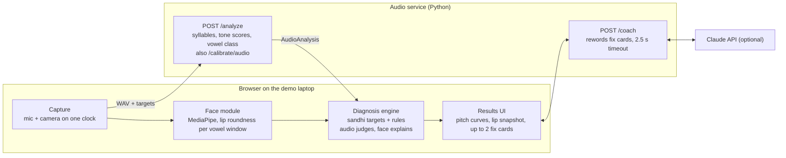

# Mandarin tone & mouth-shape coach: hackathon build spec
2026-10-10 · @Micah Killmer

> Source: the team's Claude Doc spec, copied here so every agent can read it. This file describes the full 4-agent plan; for how the two of us split it, see [docs/WORKFLOW.md](docs/WORKFLOW.md).

## Overview
ToneMirror (working name) is a browser app that listens to a learner say a Mandarin word, watches their lips, and tells them which tone or mouth shape went wrong and how to fix it. The demo proves one claim: combining audio with face tracking turns “you got it wrong” into “here is what your mouth did.”
**In scope for the demo**
- Tones on 1–3 syllable words, including tone sandhi (3+3, 不, 一) and the half third tone.
- One vowel family done properly: i / ü / u, diagnosed with formants plus lip rounding.
- A 25-second calibration per user: voice range, vowel anchors, face poses.
- Per-syllable feedback: pitch curve vs. target, lip snapshot vs. target, a one-line fix, and an optional LLM-polished tip.
**Out of scope (say “next” if judges ask)**
- Free conversation and full-sentence scoring.
- Tongue-only contrasts: zh/z, -n/-ng. The camera cannot see the tongue.
- Mobile app, accounts, cloud storage, training any ML model.
**Assumptions**: a 24-hour hackathon, 2–4 people plus coding agents, laptops with webcams, and ideally one teammate who speaks Mandarin natively or fluently. If nobody does, see the fallbacks in the risks section.
**Demo success criteria**
- Results appear under 3 seconds after the learner stops speaking.
- On the four rehearsed demo utterances, the app gives the intended diagnosis at least 9 of 10 tries.
- Everything works offline except the optional LLM tip.

## Demo script
The 3-minute demo builds to one moment: the same wrong word gets two different fixes, depending on what the learner's mouth did. Every other beat sets that up.
| Time | Presenter does | Screen shows | What it proves |
|---|---|---|---|
| 0:00–0:20 | Hook: “Apps give you a score. A teacher tells you what your mouth is doing. We built the teacher part.” | Start screen | The problem |
| 0:20–0:40 | Shows calibration ran (or runs it fast): siren glide, “ee”, “oo”, “ah” | Calibration progress, live lip overlay | It adapts to each voice and face |
| 0:40–1:10 | Says 妈 麻 马 骂 with a tone 2 that dips before rising | Four pitch curves on a 1–5 scale; 麻 flagged “dipped first, sounds like tone 3”. Retry turns green | Tone feedback you can see |
| 1:10–1:35 | Says 你好 with two full tone-3 dips | First syllable flagged: “before another tone 3, 你 becomes ní”; target vs. yours | It knows sandhi rules, not a lookup |
| 1:35–2:05 | Says 女 nǚ as “nee” (lips spread) | Lip snapshot shows spread lips beside the rounded target. Fix: “Keep your tongue as for ‘ee’, round your lips” | Face explains the error |
| 2:05–2:20 | Says 女 as “noo” (lips rounded, tongue back) | Lips marked correct. Fix: “Your tongue slid back to ‘oo’” | Same wrong word, different fix |
| 2:20–2:40 | Says 女 correctly | Both panels green | It recognizes success |
| 2:40–3:00 | Close on the architecture diagram | What's next: tongue sounds via audio models, error tables per native language, mobile | Credible roadmap |
**Rehearsal notes**
- Practice the deliberate wrong versions until they're reliable. The app is honest; a sloppy “wrong” take may come out right.
- Use a headset or lapel mic. Hackathon halls are loud and pitch tracking degrades with noise.
- Put a light in front of the presenter's face, never behind.
- Keep demo mode (scripted sequence) and a backup screen recording ready.

## Architecture and tech stack
The browser handles capture, face tracking, diagnosis and UI; a small Python service handles pitch and formant analysis. MediaPipe runs well in the browser, and Praat (through Parselmouth) is the most dependable pitch and formant toolkit, which is Python.

Video stays in the browser; only audio goes to the local service.
Audio goes to the local Python service; camera frames stay in the browser and become lip numbers; the diagnosis engine merges both.
| Layer | Choice | Why | Owner |
|---|---|---|---|
| Frontend | Vite + React + TypeScript | Fast to scaffold; agents know it well | A1 |
| Audio capture | getUserMedia, then encode 16 kHz mono WAV in the browser | No ffmpeg needed on the server | A1 |
| Face tracking | `@mediapipe/tasks-vision` FaceLandmarker, VIDEO mode, GPU delegate | 478 landmarks + 52 blendshapes in real time; video never leaves the laptop | A2 |
| Audio analysis | Python 3.11, FastAPI, `praat-parselmouth`, numpy, scipy | Praat-grade pitch and formants | A3 |
| Diagnosis | Pure TypeScript module, rules stored as data | Unit-testable, no network | A4 |
| Pitch chart | Hand-rolled SVG | Full control of the 1–5 tone scale | A1 |
| Coaching text | Claude API via a backend `/coach` endpoint, fast model, template fallback | Phrasing only, never diagnosis | A4 |
| Optional | Azure Pronunciation Assessment (zh-CN) for an overall score badge | Off the critical path | Stretch |
**Repo layout**
```
tonemirror/
  SPEC.md                  # this document
  shared/
    contracts/types.ts     # source of truth for data shapes
    fixtures/              # JSON + WAV for every demo utterance
  apps/web/                # Vite React app
    public/models/face_landmarker.task
    public/ref/            # native reference audio + target images
    src/capture/           # mic, camera, WAV encoder, recorder (A1)
    src/face/              # MediaPipe loop, features, calibration (A2)
    src/diagnosis/         # sandhi, rules engine, messages (A4)
    src/content/           # prompts.ts (A4)
    src/ui/                # screens and charts (A1)
  services/audio/          # FastAPI service (A3)
    app/main.py  app/models.py  app/pitch.py
    app/segment.py  app/tone.py  app/vowel.py  app/coach.py
    tests/
```
**Request flow for one attempt**
1. The learner presses record. The face loop logs lip features about 30 times a second; the mic records audio. Both use the same clock.
2. Recording stops after 600 ms of silence, or at 3 seconds.
3. The browser posts the WAV, prompt ID and calibration to `POST /analyze`.
4. The service returns syllable timings, tone results and vowel formants.
5. The browser summarizes face features inside each vowel's time window.
6. The diagnosis engine merges audio and face evidence into at most two fixes.
7. The UI renders results immediately, then swaps in coaching text from `/coach` if it arrives within 2.5 seconds.

## Shared data contracts
These types are the only coupling between agents: freeze them by hour 2 and change them only through the lead. They live in `shared/contracts/types.ts`, mirrored as pydantic models in `services/audio/app/models.py`. Times are seconds from recording start; pitch levels use the Chao 1–5 tone scale.
```ts
export type Tone = 1 | 2 | 3 | 4 | 5;            // 5 = neutral tone
export type ToneVariant = "T1" | "T2" | "T3_full" | "T3_half" | "T4" | "T5";
export type VowelClass = "i" | "y" | "u" | "other";   // y = ü
export type TargetVisual = "spread" | "rounded" | "open" | "neutral";

export interface PromptItem {
  id: string;                 // "nv3"
  hanzi: string;              // "女"
  pinyin: string[];           // ["nv3"]  numbered tones, v = ü
  gloss: string;              // "woman"
  reading: "word" | "list";   // list = each syllable said in isolation
  focus: ("tone" | "vowel")[];
  vowelTargets?: (VowelClass | null)[];  // per syllable, only for vowel prompts
  refAudioUrl?: string;
  targetVisual?: TargetVisual;
}

export interface SyllableTarget {
  index: number;
  pinyin: string;             // as written: "ni3"
  surfaceTone: Tone;          // after sandhi: 2 for 你 in 你好
  variant: ToneVariant;
  sandhiNote?: string;        // "3+3 → 2+3"
  vowel?: VowelClass;
}

export interface Formants { F1: number; F2: number; F3: number }

export interface AudioCalibration {
  f0: { medianHz: number; lowHz: number; highHz: number };  // 5th / 95th pct
  formantCeilingHz: 5000 | 5500;
  anchors: { i: Formants; u: Formants; a: Formants };
}

export interface FaceFeatures {
  t: number;                  // seconds since recording start
  detected: boolean;
  lipWidth: number;           // inner lip width / interocular distance
  lipHeight: number;          // inner lip gap / interocular distance
  pucker: number;             // blendshape 0–1
  funnel: number;
  jawOpen: number;
  smile: number;              // mean of mouthSmileLeft and mouthSmileRight
}

export interface FaceCalibration {
  neutral: FaceFeatures; ee: FaceFeatures; oo: FaceFeatures; ah: FaceFeatures;
}

export interface Calibration { audio: AudioCalibration; face: FaceCalibration; createdAt: string }

export type ToneIssueId = "t1_drift" | "t1_low" | "t2_shallow" | "t2_late" |
  "t3_not_low" | "t3_full_in_context" | "t4_shallow" | "t4_low_start" |
  "wrong_tone" | "no_pitch";

export interface ToneResult {
  target: ToneVariant;
  producedChao: number[];     // 10 points on the 1–5 scale
  targetChao: number[];       // 10 points
  nearest: ToneVariant;       // template the production is closest to
  rmse: number;               // Chao units vs. target
  score: number;              // 0–100
  issues: ToneIssueId[];
  voicedRatio: number;        // share of the syllable with a pitch reading
}

export interface VowelResult {
  target: VowelClass;
  formants: Formants;
  f2n: number;                // 0 = like your “oo”, 1 = like your “ee”
  f3ratio: number;            // F3 / F3 of your “ee”
  heardAs: VowelClass;
  glide: boolean;             // vowel slid, like English “you”
  confidence: number;         // 0–1
}

export interface SyllableAnalysis {
  index: number;
  target: SyllableTarget;
  start: number; end: number;
  vowelStart: number; vowelEnd: number;   // window used for formants and face
  tone: ToneResult;
  vowel?: VowelResult;
}

export interface AudioAnalysis {
  promptId: string;
  durationSec: number;
  syllables: SyllableAnalysis[];
  warnings: ("too_quiet" | "clipped" | "syllable_count_mismatch" | "noisy")[];
}

export interface FaceSummary {
  syllableIndex: number;
  roundness: number;          // 0 = your “ee”, 1 = your “oo”
  jawOpen: number;
  coverage: number;           // share of frames in the window with a face
  snapshot?: string;          // data URL, mouth crop at vowel midpoint
}

export interface Diagnosis {
  syllableIndex: number;
  issueId: string;            // "y_lips_not_rounded", "t2_late", ...
  articulator: "pitch" | "lips" | "tongue" | "jaw";
  severity: 1 | 2 | 3;        // 3 = fix this first
  evidence: Record<string, number | string | boolean>;
  messageKey: string;
}

export interface FeedbackItem {
  diagnosis: Diagnosis;
  title: string;              // "Round your lips"
  instruction: string;        // template text, always present
  coaching?: string;          // LLM-polished text, may arrive later
  targetVisual?: TargetVisual;
}
```
**Endpoints (audio service)**
| Method and path | Request | Response |
|---|---|---|
| `POST /analyze` | multipart: `audio` (WAV), `meta` (JSON: `promptId`, `targets: SyllableTarget[]`, `calibration: AudioCalibration`) | `AudioAnalysis` |
| `POST /calibrate/audio` | multipart: `glide`, `ee`, `oo`, `ah` WAVs | `AudioCalibration` |
| `POST /coach` | `{ prompt: PromptItem, items: FeedbackItem[] }` | `{ tips: { issueId: string, text: string }[] }` |
| `GET /health` | none | `{ ok: true }` |
The browser computes `SyllableTarget[]` (sandhi rules live in TypeScript) and sends them, so the service never needs its own copy of the prompt list.
**Fixtures**: `shared/fixtures/` holds one `AudioAnalysis` JSON and one `FaceSummary[]` JSON for every demo utterance, in both correct and wrong variants. With `VITE_AUDIO_MODE=fixture` the frontend runs without the service; with `VITE_FACE_MODE=fixture` it runs without a camera.

## Module A: recording and alignment
Record a 16 kHz mono WAV per attempt and split it into syllables using voicing and loudness. No external forced aligner is needed, because every prompt is 1–4 known syllables.
**Capture (browser, A1)**
- `getUserMedia({ audio: { echoCancellation: false, autoGainControl: false }, video: { width: 640, height: 480, facingMode: "user" } })`. Test `noiseSuppression` on and off in the venue and keep whichever gives cleaner pitch.
- One clock: `t0 = performance.now()` when audio capture starts. The face loop stamps frames as `(performance.now() - t0) / 1000`.
- Capture raw PCM with an AudioWorklet, downsample to 16 kHz, encode 16-bit WAV in the browser.
- Visual 3-2-1 countdown, then record. Auto-stop after 600 ms below the speech threshold once speech has started, or at 3.0 s (4.0 s for list prompts).
- Live level meter. Reject before sending if the peak is under −30 dBFS (“speak up”) or over 1% of samples clip (“move back a little”).
**Segmentation (service, A3), in `segment.py`**
1. Pitch: `snd.to_pitch_ac(time_step=0.01, pitch_floor=0.7*lowHz, pitch_ceiling=1.5*highHz)`. Before calibration, use 75 and 500 Hz.
2. Loudness: `snd.to_intensity(time_step=0.01)`. Speech frames are those within 25 dB of the loudest frame.
3. Voiced runs: frames that are both voiced and speech. Merge runs separated by under 60 ms; drop runs shorter than 60 ms.
4. Match the expected syllable count N:
  1. Exactly N runs: done.
  2. Fewer: split the longest run at its deepest loudness dip (at least 3 dB below both neighbors). Repeat until N.
  3. More: merge the pair with the shortest gap. Repeat until N.
  4. Still impossible: add warning `syllable_count_mismatch` and return the best effort.
5. Vowel window per syllable: drop the first 30% (onset consonant, voiced initials like n and m) and the last 15%. For vowel-focus syllables, use the central 40%.
**Stretch**: Azure Pronunciation Assessment word offsets, or Montreal Forced Aligner, for full sentences.
**Done when**: 18 of 20 teammate recordings of the prompt set segment correctly, checked by eye against Praat.

## Module B: tone analysis
Each syllable's pitch is scaled to the learner's own voice range, mapped to the 1–5 tone scale, and compared with a target template that already accounts for tone sandhi. Comparing contour shapes inside the learner's range, not raw hertz, is what makes it work for deep and high voices alike.

### B1. Targets from pinyin (TypeScript, A4: `src/diagnosis/sandhi.ts`)
Apply in this order to the written tones:
1. 不 `bu4` becomes `bu2` before a tone 4.
2. 一 `yi1` becomes `yi2` before a tone 4, and `yi4` before tones 1, 2 and 3. It stays `yi1` when final. The prompt set avoids numbers, where it also stays `yi1`.
3. In a run of third tones, all but the last become tone 2. This is enough for 2–3 syllable words; real phrasing is more complex.
4. A remaining tone 3 that is not final becomes `T3_half`; a final or isolated one is `T3_full`. In `reading: "list"` prompts, every syllable counts as isolated.
5. Neutral tone (5) sits at a height set by the previous tone: after tone 1 at level 2, after 2 at 3, after 3 at 4, after 4 at 1. It is short and flat.
Each changed syllable gets a `sandhiNote` the UI can show, for example “3+3 → 2+3”.

### B2. Contour extraction (Python, A3: `tone.py`)
1. Take voiced pitch frames inside the syllable; trim 10% from each end.
2. Fill gaps of 80 ms or less by linear interpolation; apply a 5-frame median filter.
3. Convert to semitones: `st = 12 * log2(f0 / medianHz)`.
4. Scale to the tone scale: `level = 1 + 4 * (st - lowSt) / (highSt - lowSt)`, clamped to 0.5–5.5. `lowSt` and `highSt` come from the 5th and 95th percentile of the calibration siren glide.
5. Resample to 10 evenly spaced points.
**Creaky voice**: tone 3 often turns creaky at the bottom, and pitch trackers drop out there. If a tone-3 target has a gap in its middle 60% but voiced edges, fill the gap with level 1 instead of flagging `no_pitch`.

### B3. Templates
Build each 10-point template by linear interpolation between anchor points (position 0–1, level 1–5).
| Variant | Anchors | Shape |
|---|---|---|
| `T1` | (0, 5) → (1, 5) | High, level |
| `T2` | (0, 3) → (0.2, 2.7) → (1, 5) | Mid, slight dip, rise |
| `T3_full` | (0, 2) → (0.6, 1) → (1, 4) | Low dip, then rise |
| `T3_half` | (0, 2) → (1, 1) | Low, falling, no rise |
| `T4` | (0, 5) → (1, 1) | High to low |
| `T5` | flat at the B1 rule height | Short, light |

### B4. Scoring
- `rmse` = root-mean-square distance between produced and target points, in tone-scale levels.
- Status: 0.6 or less is green, up to 1.1 is amber, above 1.1 is red.
- `score = round(100 * clamp(1 - rmse / 2, 0, 1))`.
- `nearest` = the template with the smallest rmse. If it differs from the target and beats it by more than 0.3, add `wrong_tone` (“sounded like tone 3”).

### B5. Issue detectors
Start, end, min and max refer to the 10-point produced contour.
| Issue | Rule | Message template |
|---|---|---|
| `t1_drift` | abs(end − start) > 1.0 | Keep it flat; your tone 1 slid {up/down}. |
| `t1_low` | mean < 3.8 | Tone 1 sits at the top of your voice. Start higher. |
| `t2_shallow` | max − min < 1.5 | Rise more: from the middle of your voice to the top. |
| `t2_late` | min falls after point 4 and dips ≥ 0.7 below start | You dipped before rising, which sounds like tone 3. Start rising right away. |
| `t3_not_low` | min > 2.0 | Go lower. Tone 3 lives at the bottom of your voice. |
| `t3_full_in_context` | target `T3_half` and end − min > 1.5 | Info only: mid-phrase, tone 3 just stays low. |
| `t4_shallow` | start − end < 2.0 | Fall further, from top to bottom, like a firm “No!” |
| `t4_low_start` | start < 4.0 | Start tone 4 higher. |
| `no_pitch` | voicedRatio < 0.3 | I couldn't hear a clear pitch. Try again a bit louder. |
**Done when**: unit tests on synthetic contours pass for every template and issue; the native reference recordings score green on at least 90% of syllables; every deliberate error in the golden set gets flagged.

## Module C: segment check (vowels)
The demo checks one vowel family, i / ü / u, using formants measured against the learner's own “ee” and “oo” from calibration. Rounding the lips lowers F2 and especially F3; pulling the tongue back lowers F2 a lot. That splits the two classic learner errors cleanly.
**Procedure (Python, A3: `vowel.py`)**
1. Formant ceiling: 5500 Hz if the calibration median F0 is above 165 Hz, else 5000 Hz. Call `snd.to_formant_burg(time_step=0.01, max_number_of_formants=5, maximum_formant=ceiling, window_length=0.025)`.
2. In the vowel window, take the median F1, F2, F3. Also take median F2 in the first and last thirds, for glide detection.
3. Normalize against calibration: `f2n = (F2 - F2_u) / (F2_i - F2_u)` and `f3ratio = F3 / F3_i`.
4. Classify. These thresholds are starting guesses; tune them on the golden recordings in hours 8–12.
  - `f2n < 0.45` → heard as **u** (tongue back)
  - else `f3ratio < 0.90` → heard as **ü** (front and rounded)
  - else → heard as **i** (front, unrounded)
  - `abs(F2_last - F2_first) / F2_mid > 0.25` → `glide: true` (a slide like English “you”)
5. Confidence: distance from the nearest threshold, scaled to 0–1. Below 0.3, the diagnosis engine still lets the audio decide the verdict but words the fix more cautiously.
**Pinyin trap**: ü is written as plain u after j, q, x and y (qù, xué, yú). Content marks these syllables as vowel `y`, and the UI notes “this u is really ü”.
**Stretch goals, in priority order**
1. e (as in 喝 hē) vs. o: e is unrounded, so a rounded e is an easy face-plus-audio catch.
2. The buzzing vowel in 四 sì vs. “see”: F2 should sit well below the learner's own “ee”.
3. Aspiration (p, t, k, q, ch, c vs. b, d, g, j, zh, z): time from burst to voicing. Under about 40 ms reads as unaspirated, over about 60 ms as aspirated. Tune on native recordings.
4. s / sh / x: spectral peak of the hiss, highest for s and lowest for sh. Needs native calibration.
5. Overall score badge from Azure Pronunciation Assessment (zh-CN).
**Done when**: across 10 recordings each of a teammate saying nǚ, “nee” and “noo”, `heardAs` is right at least 9 of 10 times per category.

## Module D: face tracking and lip checks
MediaPipe FaceLandmarker runs in the browser at camera rate and logs a few lip measurements per frame, each with a timestamp. No video leaves the laptop; only numbers and one mouth snapshot are kept, locally.
**Setup (A2: `src/face/`)**
- `FaceLandmarker.createFromOptions` with `runningMode: "VIDEO"`, `numFaces: 1`, `outputFaceBlendshapes: true`, `delegate: "GPU"` (fall back to CPU on error).
- Serve `face_landmarker.task` and the WASM files from `public/`. Don't depend on a CDN at the venue.
- Loop on `requestAnimationFrame`: `detectForVideo(video, performance.now())`. While recording, push a `FaceFeatures` row every frame and an `ImageBitmap` about 10 times a second (for snapshots). Otherwise keep only a 3-second ring buffer.
**Features per frame.** Verify these landmark indices in hour 1 by drawing them on the preview.
| Feature | Source | Notes |
|---|---|---|
| Scale unit | Distance between outer eye corners, landmarks 33 and 263 | Makes features independent of distance to camera |
| `lipWidth` | Inner mouth corners, landmarks 78 and 308 | Divided by scale unit |
| `lipHeight` | Inner lip midpoints, landmarks 13 and 14 | Divided by scale unit |
| `pucker`, `funnel`, `jawOpen` | Blendshapes `mouthPucker`, `mouthFunnel`, `jawOpen` | Already 0–1 |
| `smile` | Mean of `mouthSmileLeft` and `mouthSmileRight` | Helps detect spread lips |
**Roundness score**
```
widthTerm  = (W_ee - W) / (W_ee - W_oo)          // from face calibration
puckerTerm = (P - P_ee) / (P_oo - P_ee)
roundness  = clamp(0.6 * widthTerm + 0.4 * puckerTerm, 0, 1)
```
Roundness of 0.6 or more counts as rounded, 0.3 or less as spread, anything between as partly rounded. Tune the weights on teammates' calibration data.
**Summary per syllable**
- Window: the syllable's vowel window from the audio service, widened by 40 ms on each side to absorb sync error.
- `roundness`, `jawOpen`: medians over frames in the window. `coverage`: share of those frames with a detected face.
- `snapshot`: the stored bitmap nearest the vowel midpoint, cropped to the mouth (landmark bounding box plus 20% padding), as a data URL.
**Live quality checks**, shown as a banner on the preview:
- Face found in under 80% of frames: “Keep your face in view.”
- Eye-corner distance under 60 px: “Move closer.”
- Nose tip off the eye midpoint by more than 0.15 of the eye-corner distance: “Face the camera.”
**Live overlay**: draw the lip contour and a small roundness bar on the preview, so judges see tracking work in real time.
**Done when**: on calibration poses, roundness separates “ee” from “oo” by at least 0.5 for every teammate, and a summary for a 1-second vowel computes in under 20 ms.

## Module E: diagnosis rules engine
Audio decides whether a sound is wrong; the face only explains why. This one rule keeps face-tracking noise from ever failing a correct pronunciation, and it is the core design idea worth telling judges.
**Engine (A4: `src/diagnosis/`)**
- Pure function: `diagnose(prompt, audio: AudioAnalysis, face: FaceSummary[]): FeedbackItem[]`.
- Rules live in `rules.ts` as data: `{ id, appliesTo, when: (ctx) => boolean, articulator, severity, messageKey, targetVisual }`.
- For each syllable, evaluate rules in order; the first match per articulator wins.
- Message templates live in `messages.ts`, keyed by `messageKey`, with `{placeholders}`.
**Vowel rules, target ü**
| Heard as | Lips | Issue | Fix shown | Severity |
|---|---|---|---|---|
| any | any, with `glide: true` | `y_glide` | Don't slide like English “you”. Hold one mouth shape from start to end. | 3 |
| i | spread or partly | `y_lips_not_rounded` | Keep your tongue exactly as for “ee”. Now push your lips into a small, tight circle. | 3 |
| u | rounded | `y_tongue_back` | Your lips are right. Your tongue slid back to “oo”: keep the tip touching your lower front teeth. | 3 |
| u | spread or partly | `y_both` | Start from “ee”, hold your tongue still, then round your lips. | 3 |
| ü | spread | `y_ok_lips_hint` | Sounds right. Rounding your lips more will make it steadier. | 1 |
| ü | rounded or partly | pass | none | none |
**Other vowel targets**
| Target | Heard as | Lips | Issue | Fix shown |
|---|---|---|---|---|
| u | i or ü | partly or spread | `u_fronted` | Round tighter and pull your tongue back, deeper than English “oo”. |
| i | ü | rounded | `i_rounded` | Spread your lips, like a slight smile. |
**When the face is missing** (coverage under 0.5): use audio-only messages that name both possible causes, for example “Sounded like ‘ee’: round your lips, keep your tongue forward.”
**Tone rules**: each `ToneIssueId` maps one-to-one to a diagnosis with `articulator: "pitch"`. `wrong_tone` and `no_pitch` are severity 3; `t3_full_in_context` is severity 1 (info).
**Prioritization**
- At most two fix cards per attempt. Highest severity first; ties go to the earlier syllable.
- One card per syllable, unless its tone and vowel issues are both severity 3.
- Correct syllables get a green chip and no text.
**Done when**: table-driven unit tests cover every row above using the fixtures, and the four demo utterances produce exactly the scripted fixes.

## Module F: feedback UI and coaching
Four screens, and the results screen does the selling: a pitch curve, a lip comparison and one sentence per problem.
**Screens (A1: `src/ui/`)**
1. **Start**: pick a practice set (Tones, Sandhi, The ü sound) or Demo mode, which runs the scripted sequence in order.
2. **Calibration**, about 25 seconds, once per user, saved to `localStorage`: neutral face (2 s), “ā” held (2 s), siren glide from high to low, “yī” held, “wū” held. Progress dots and a live waveform.
3. **Practice**: large hanzi, pinyin with tone marks, English gloss, a play-native button. Camera preview with lip overlay and roundness bar. A big record button with 3-2-1 countdown and auto-stop.
4. **Results**:
  - Syllable chips, green, amber or red, each with its surface tone mark. When sandhi applied, a note such as “你 becomes ní before another tone 3”.
  - Pitch panel: SVG with gridlines at levels 1–5; per syllable, a dashed target curve and a solid learner curve, side by side.
  - Lip panel (vowel prompts only): the learner's mouth snapshot beside the target illustration, and a roundness gauge with the target band shaded.
  - Fix cards (at most two): title plus instruction, swapped for coaching text when it arrives.
  - Buttons: hear yourself, hear native, try again. A retry keeps the previous attempt drawn faintly for comparison.
Status chips use color plus an icon plus a word, so they work for color-blind judges.
**Target visuals**: four simple front-view SVG mouths (spread, rounded and pushed forward, open, neutral), drawn once. Exaggerate the target shape by about 20%: earlier research found exaggerated visual feedback helped learners. Replace with photos of the native teammate if time allows.
**Coaching endpoint (A4: `services/audio/app/coach.py`)**
- `POST /coach` receives the prompt and the fix cards; returns one rewritten tip per issue.
- Use a fast Claude model (for example `claude-haiku-5-5`), temperature 0.3, at most 120 output tokens per tip.
- Timeout 2.5 seconds. The UI renders template text first and never waits on the LLM.
- Keep the API key server-side only, in `.env`.
System prompt:
```
You are a friendly Mandarin pronunciation coach for English-speaking beginners.
You receive JSON describing one pronunciation problem that has already been
diagnosed, plus a template instruction. Rewrite the instruction as a tip of at
most two short sentences. Rules:
- Never add, remove or change the diagnosis. Only rephrase it.
- Describe physical actions (lips, tongue, voice pitch), not phonetic terms.
- If you mention a sound, compare it to a common English word.
- No praise filler. Return only the tip text.
```

## Content: prompts, references and calibration
Eleven prompts cover every demo beat; four are rehearsed for judges. They live in `src/content/prompts.ts` as `PromptItem` objects (A4).
| ID | Hanzi | Written pinyin | Surface target | Focus | Demo beat |
|---|---|---|---|---|---|
| `ma4` | 妈 麻 马 骂 | ma1 ma2 ma3 ma4 (list) | unchanged, 马 full tone 3 | Tone | Tones |
| `nihao` | 你好 | ni3 hao3 | ni2 hao3 | Sandhi 3+3 | Sandhi |
| `nv` | 女 | nv3 | nv3, vowel ü | ü + tone | Money shot |
| `ni` | 你 | ni3 | vowel i | Contrast for ü | Practice |
| `nu` | 努 | nu3 | vowel u | Contrast for ü | Practice |
| `qu` | 去 | qu4 | vowel ü, written u | Pinyin trap | Practice |
| `yu` | 鱼 | yu2 | vowel ü, written u | ü + tone 2 | Practice |
| `bushi` | 不是 | bu4 shi4 | bu2 shi4 | Sandhi 不 | Practice |
| `yige` | 一个 | yi1 ge4 | yi2 ge4 | Sandhi 一 | Practice |
| `laoshi` | 老师 | lao3 shi1 | half tone 3 + tone 1 | Half third tone | Practice |
| `zhongguo` | 中国 | zhong1 guo2 | unchanged | Tones 1 + 2 | Practice |
**Calibration script** (sent as four WAVs to `/calibrate/audio`, face poses captured at the same time):
1. Neutral face, mouth relaxed, 2 seconds (face only).
2. “Ahh” held for 2 seconds: the a anchor and the open-jaw pose (`ah`).
3. A siren glide from your highest comfortable pitch down to your lowest: the pitch range (`glide`).
4. “Eee” held for 2 seconds: the i anchor and the spread-lips pose (`ee`).
5. “Ooo” held for 2 seconds: the u anchor and the rounded-lips pose (`oo`).
**Reference recordings** (native or fluent teammate, hours 0–4):
- Record each prompt three times in a quiet spot with the demo mic; keep the best take as `public/ref/<id>.wav`.
- Take a front-facing photo at the vowel midpoint of 你, 女 and 努 for the target visuals.
- No native speaker on the team: use a zh-CN neural TTS voice for reference audio, rely on the tone templates, and use the SVG mouths only.
**Golden test set** (`shared/fixtures/audio/`, five takes each):
- Correct versions of all four demo utterances.
- 女 said as “nee”, as “noo”, and as a “yoo” glide.
- 麻 with a dip before the rise; 你好 with two full dips; 骂 with a shallow fall.
These recordings drive threshold tuning, regression tests, and the fixture JSON the frontend uses before the service is ready.

## Agent plan
Run four coding agents in parallel, each owning one directory and building against the shared contracts and fixtures. A human lead merges every two hours and is the only one who edits `shared/`.
**Ground rules**
- Put this spec in the repo as `SPEC.md` and point each agent at its sections.
- Contracts freeze at hour 2. Changes go through the lead, who updates the TypeScript and pydantic copies together.
- One branch or git worktree per agent. Small commits, tests with every module.
- Mock first: every module ships a fake behind the same interface (fixture mode), so nothing blocks on anything else.
- Agents never touch another agent's directory. If they need a change there, they write a note in `NOTES.md` for the lead.
| Agent | Owns | First delivery (on mocks) | Final delivery | Spec sections |
|---|---|---|---|---|
| Lead (you + one agent) | Repo, `shared/`, integration, demo mode | Scaffold, contracts, fixture JSON by hour 2 | Merged app, demo mode, rehearsal | All |
| A1 Frontend | `apps/web/src/capture`, `src/ui` | All four screens running on fixtures | Real capture, WAV encoder, pitch chart, results | Architecture, A, F |
| A2 Face | `apps/web/src/face` | Fake `FaceSummary` generator | MediaPipe loop, features, calibration, snapshots, overlay | D |
| A3 Audio | `services/audio` (except `coach.py`) | `/analyze` returning fixture JSON | Segmentation, tone scoring, formants, calibration endpoint | A, B2–B5, C |
| A4 Brain | `src/diagnosis`, `src/content`, `services/audio/app/coach.py` | Rules engine plus tests on fixtures | Sandhi, all rules, messages, prompts, coaching | B1, E, F (coaching), Content |
**Kickoff prompts.** Paste the shared preamble, then the agent's own block.
```
SHARED PREAMBLE
You are building one module of ToneMirror, a Mandarin pronunciation coach.
Read SPEC.md in full, then re-read the sections named below.
Data shapes are defined in shared/contracts/types.ts. Do not edit shared/.
Only create or edit files inside your owned directory.
Build a fixture/mock version first so other modules can integrate,
then the real version behind the same interface.
Write tests for every function with logic. Keep commits small.
If the spec is ambiguous, choose the simplest option and log it in NOTES.md.
```
```
A1 FRONTEND
Own apps/web/src/capture and apps/web/src/ui. Sections: Architecture, Module A
(capture), Module F. Step 1: build the four screens on fixture data
(VITE_AUDIO_MODE=fixture, VITE_FACE_MODE=fixture). Step 2: real mic and camera
capture with a shared clock, AudioWorklet PCM capture, 16 kHz WAV encoder,
auto-stop on silence, level checks. Step 3: SVG pitch chart (levels 1-5,
dashed target, solid learner), lip panel, fix cards, demo mode sequence.
```
```
A2 FACE
Own apps/web/src/face. Section: Module D. Export: startFaceLoop(video, clock),
startRecording(), stopRecording(): FaceFeatures[], captureCalibrationPose(name),
summarize(frames, windows, calibration): FaceSummary[], plus a live overlay
component. Serve the model and WASM from public/. First ship a fake that
returns plausible FaceSummary values. Verify landmark indices visually
before computing features.
```
```
A3 AUDIO
Own services/audio except app/coach.py. Sections: Module A (segmentation),
Module B2-B5, Module C. FastAPI + praat-parselmouth. Endpoints: POST /analyze,
POST /calibrate/audio, GET /health, with CORS for localhost. First ship
/analyze returning fixture JSON. Then real segmentation, tone contours and
scoring, formants and vowel classification. Unit-test tone scoring with
synthetic contours; regression-test on shared/fixtures/audio.
```
```
A4 BRAIN
Own apps/web/src/diagnosis, apps/web/src/content and
services/audio/app/coach.py. Sections: Module B1, Module E, Module F
(coaching), Content. Build: sandhi.ts (pinyin to SyllableTarget[]), rules.ts
and messages.ts, diagnose() with table-driven tests for every rule row,
prompts.ts with the 11 prompts, and POST /coach with a 2.5 s timeout and
template fallback.
```
**Integration order**
1. A1 + A3: record, call `/analyze`, draw the pitch chart. Tone path end-to-end.
2. A4 on top: sandhi targets in, tone fix cards out.
3. A2: face summaries into the diagnosis engine.
4. Vowel path: formants plus roundness, the money-shot beat.
5. Coaching text, calibration polish, demo mode.
**Merge checklist**: tests pass; fixture mode still runs with the service stopped; no edits to `shared/` outside the lead.

## Timeline
The tone path must work end to end by hour 12; face tracking and the vowel check build on top of it. If you have 36 or 48 hours, stretch the middle phases and keep the gates in the same order.
| Hours | Phase | What happens |
|---|---|---|
| 0–2 | Setup and spikes | Lead: scaffold, contracts, fixture JSON. Native speaker starts recordings. Spikes: MediaPipe on the demo laptop, Parselmouth pitch on one WAV. |
| **Gate, hour 2** | | Contracts frozen, agents start |
| 2–8 | Parallel build on mocks | A1 screens on fixtures, A2 face features, A3 segmentation and tones, A4 sandhi, rules and prompts. Golden test set recorded. |
| 8–12 | Integration 1: tone path | Record, analyze, pitch chart and tone fix cards end to end. Tune tone thresholds on the golden set. |
| **Gate, hour 12** | | Tone path works end to end, or face runs in fixture mode. This gate decides the demo. |
| 12–16 | Integration 2: face and vowels | Face summaries into the diagnosis engine; formant vowel check. The nǚ money shot works for two people. |
| **Gate, hour 16** | | ü diagnosis 9 of 10, or demo with the presenter's tuned profile |
| 16–20 | Polish | Coaching text, calibration flow, demo mode, lip overlay, results screen. Second regression run. |
| **Gate, hour 20** | | Feature freeze |
| 20–24 | Rehearse and submit | Venue test with the headset mic; rehearse five times; record the backup video. |
Miss the hour-12 gate and the demo becomes a tone coach with recorded face data, which still tells the story.

## Testing, risks and fallbacks
The biggest threats are room noise and a mistuned vowel threshold, and both have cheap fallbacks. Decide at the hour-12 and hour-16 gates; never debug live in front of judges.
**Tests**
- Unit: sandhi rules (every case in B1), tone templates and detectors on synthetic contours, rules engine (every row in Module E), roundness math.
- Regression: run the golden test set through `/analyze` and `diagnose()` after each merge. Print a pass/fail table of intended vs. actual diagnosis.
- Acceptance: each of the four demo utterances gives the scripted result 9 of 10 times, by two different teammates, in the venue.
| Risk | Likelihood | Fallback |
|---|---|---|
| Hall noise breaks pitch tracking | High | Headset or lapel mic; record calibration in the venue; raise the speech threshold |
| ü / i / u thresholds misfire on a new voice | Medium | Tune on golden set; add a quick personal ü-attempt step to calibration; demo with the tuned presenter's voice |
| MediaPipe slow or fails on demo laptop | Medium | CPU delegate; drop to 15 fps; `VITE_FACE_MODE=fixture` with recorded face data |
| Audio and video drift out of sync | Medium | 40 ms window padding already; median over the window; worst case use the whole syllable |
| Syllable splitting fails on connected speech | Medium | Demo uses isolated words; add short pauses for list prompts |
| LLM call slow or offline | Medium | Template text always shows first; coaching is a bonus |
| No native speaker for reference audio | Depends on team | TTS reference audio, tone templates, SVG target mouths |
| Venue Wi-Fi down | Medium | Everything runs on localhost; model files served locally |
| Live demo fails anyway | Low | Demo mode replays recorded attempts through the real pipeline; backup screen recording |
**Demo-day kit**: headset mic, a small front light, the laptop on power, fixture mode tested, the backup video on the desktop, and the calibration for the presenter saved in advance.

## References
Background research behind the design choices, found earlier in this conversation. Thresholds in this spec are engineering starting points, not taken from these papers.
**Tone analysis**
- [Evaluating Mandarin tone pronunciation accuracy with a ResNet-based Siamese network](https://pmc.ncbi.nlm.nih.gov/articles/PMC12238616/): pitch contours per syllable, compared with standard pronunciation.
- [Tone error detection of continuous Mandarin speech for L2 learners (TAM-BLSTM)](https://ebooks.spiedigitallibrary.org/conference-proceedings-of-spie/12258/1225816/Tone-error-detection-of-continuous-Mandarin-speech-for-L2-learners/10.1117/12.2639121.full): tone detection in connected speech.
- [Tone production of Vietnamese learners, including third tone sandhi and the half third tone](https://guarant.cz/icphs2023/48.pdf).
**Mispronunciation detection and feedback**
- [Phonological-level Wav2Vec2 for Mandarin mispronunciation detection and diagnosis](https://arxiv.org/pdf/2606.22022): separating segmental from tonal errors.
- [A Mandarin L2 learning app with mispronunciation detection and feedback](https://www.isca-archive.org/interspeech_2020/xie20_interspeech.html).
- [Visual-speech synthesis of exaggerated corrective feedback](https://arxiv.org/abs/2009.05748v2): exaggerated feedback outperformed plain feedback.
- [Unlocking large audio-language models for interactive language learning](https://arxiv.org/abs/2601.14744v1): off-the-shelf audio LLMs are weak at detection, hence LLM for phrasing only.
**Lips and visual cues**
- [Audio-visual phoneme classification for pronunciation training (Swedish, ARTUR)](https://www.academia.edu/451414/Audio_Visual_Phoneme_Classification_for_Pronunciation_Training_Applications): visual input reduced rounded/unrounded vowel confusions.
- [Lip postures of high vowels in Taiwan Mandarin](https://guarant.cz/icphs2023/703.pdf): rounding plus protrusion separates i, ü, u.
- [Learning challenging L2 sounds via computer-assisted training with an airflow model](https://www.polyu.edu.hk/sc/fh/research/research-output/journal-articles/learning-challenging-l2-sounds-via-computer-assisted-training): 3D tutor for Mandarin aspiration.
**Data**
- [OMPAL: open-source Mandarin pronunciation assessment corpus](https://www.isca-archive.org/interspeech_2025/hsieh25b_interspeech.pdf).
- [iCALL corpus of non-native Mandarin](https://www.isca-archive.org/interspeech_2015/chen15f_interspeech.pdf).
**Tools**
- MediaPipe FaceLandmarker blendshape list: [face_detection_tflite docs](https://pub.dev/documentation/face_detection_tflite/6.8.0/face_detection_tflite/Blendshape.html) (confirms no tongue output).
- [Azure Pronunciation Assessment, language learning overview](https://docs.azure.cn/en-us/ai-services/speech-service/language-learning-overview) (stretch goal).
